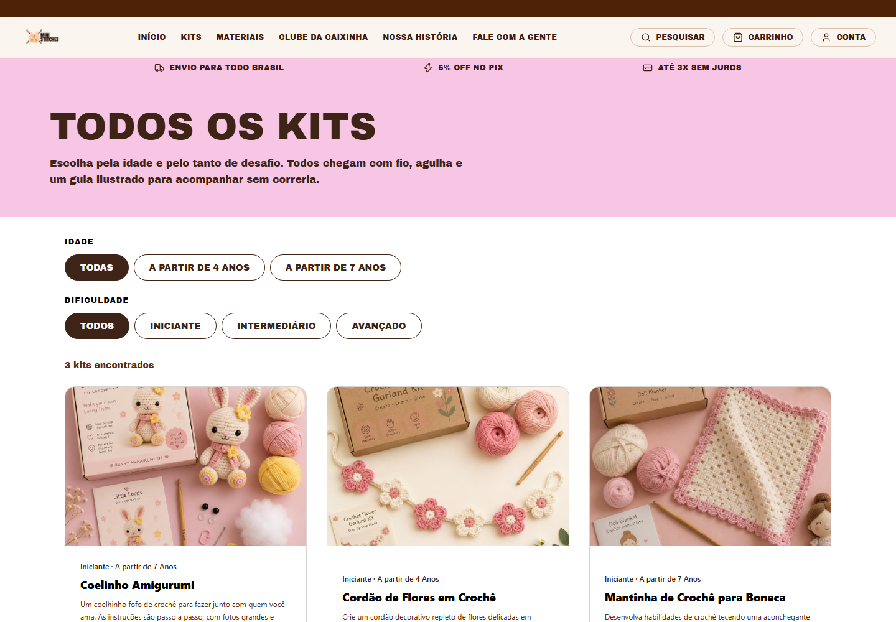

# Mini Stitches

Loja virtual de kits de bordado e crochê para crianças. A Mini Stitches apresenta os produtos, permite navegar pelo catálogo e inclui páginas de conta, carrinho, clube de assinatura e conteúdo de apoio.

## Capturas de tela

As imagens em [`docs/prints/`](docs/prints) mostram as telas públicas da loja
(início, kits, materiais, produto, carrinho, clube, trocas, contato, história,
busca, conta e erro 404), capturadas em ambiente local com dados de teste.

| Página inicial | Catálogo de kits |
| --- | --- |
|  |  |

## O que o projeto oferece

- Página inicial com apresentação da marca, destaques e conteúdo informativo.
- Catálogo de kits com filtros por idade e dificuldade e listagem de materiais.
- Detalhes de produto e carrinho que pode ser usado como visitante ou com uma conta.
- Cadastro, login, recuperação de senha por e-mail, perfil e gerenciamento de endereços, incluindo consulta de CEP pelo ViaCEP.
- Busca de kits e solicitação/consulta de trocas pelo cliente.
- Cálculo de frete no checkout a partir dos itens do carrinho e do CEP de destino, com cotação pela API do Melhor Envio.
- Pagamentos pelo Mercado Pago no checkout: Pix (com desconto), boleto e cartão de crédito, além de assinatura recorrente para o Clube da Caixinha. Um webhook recebe as atualizações de status dos pagamentos.
- Área administrativa para gerenciar produtos e conteúdos de kits.
- Páginas informativas para o Clube da Caixinha, tutoriais, trocas, história e contato.

### Carrinho lateral (RF03)

O ícone do cabeçalho e a inclusão de produtos abrem a gaveta baseada no
[frame do Figma](https://www.figma.com/design/Uf2QlLEWJ0fxL1AWvJmqSG?node-id=2038-843).
Ela permite alterar quantidades, remover produtos e acessar o checkout ou a
página completa do carrinho. Escape e o botão de fechar restauram o foco anterior.

O servidor retorna o resumo em centavos junto de cada leitura ou alteração do
carrinho, usando os preços atuais do cadastro. O Pix desconta 5% dos produtos;
as parcelas de 2x a 6x respeitam o mínimo de R$ 40 e distribuem os centavos sem
alterar o total. O frete gratuito exige subtotal acima de R$ 399,90. O resumo da
gaveta considera somente os produtos: cotação por CEP e total final, incluindo
frete, são confirmados no checkout. Produtos indisponíveis, estoque insuficiente
e falhas de atualização impedem continuar até a correção.

Os testes em `cliente/tests/pagamentos.test.cjs` cobrem resumo, limites,
arredondamento, produtos removidos, respostas atrasadas, alterações duplicadas,
atualização durante escrita e falhas de sessão. A validação visual local usa
dados fictícios e não substitui a integração com os serviços externos.

## Tecnologias

- **Interface:** React 19, React Router 7, Vite 8, Tailwind CSS 4 e Lucide React.
- **Servidor:** Node.js, Express 5, Mongoose 9 e SDK do Mercado Pago.
- **Banco de dados:** MongoDB.
- **Autenticação:** sessões Express, JWT e bcryptjs.
- **E-mail:** Nodemailer com conta Gmail (senha de app), usado na recuperação de senha.
- **Qualidade de código:** ESLint 9.
- **Serviços externos:** ViaCEP para consulta de CEP, Melhor Envio para cálculo de frete e Mercado Pago para pagamentos.

## Como rodar localmente

### 1. Pré-requisitos

- Node.js 20.19 ou superior e npm.
- MongoDB local ou uma instância MongoDB acessível pela aplicação.

### 2. Instale as dependências

Na raiz do repositório, entre na pasta da aplicação e instale os pacotes:

```powershell
cd .\cliente
npm install
```

### 3. Configure as variáveis de ambiente

Crie o arquivo `cliente/.env` e informe a conexão com seu MongoDB e segredos locais:

```env
MONGO_URI=mongodb://127.0.0.1:27017/mini_stitches
SESSION_SECRET=substitua-por-um-segredo-local
JWT_SECRET=substitua-por-outro-segredo-local
```

Para a recuperação de senha, configure também `GMAIL_USER` e `GMAIL_PASS`
(senha de app do Gmail). Em produção, `APP_URL` (URL pública HTTPS) e
`CRON_SECRET` são necessários, conforme as etapas PAG-10 e PAG-12.

Se usar MongoDB Atlas ou outra instância, substitua `MONGO_URI` pela URI correspondente. Não compartilhe nem versione esse arquivo.

Para habilitar o cálculo de frete e os pagamentos, informe também as credenciais dos serviços externos. Sem elas, essas rotas respondem com erro de configuração, mas o restante da loja continua funcionando. O arquivo `cliente/.env.example` lista todas as variáveis.

```env
# Melhor Envio (cálculo de frete)
MELHOR_ENVIO_TOKEN=
MELHOR_ENVIO_SANDBOX=true
MELHOR_ENVIO_CONTATO=seu-email@exemplo.com
CEP_ORIGEM=01000000
FRETE_SERVICOS=1,2,17
FRETE_PESO_KG=0.5
FRETE_ALTURA_CM=8
FRETE_LARGURA_CM=20
FRETE_COMPRIMENTO_CM=25

# Mercado Pago (pagamentos)
MP_PUBLIC_KEY=
MP_ACCESS_TOKEN=
MP_WEBHOOK_SECRET=
```

As dimensões e o peso do pacote (`FRETE_PESO_KG`, `FRETE_ALTURA_CM`, `FRETE_LARGURA_CM` e `FRETE_COMPRIMENTO_CM`) são obrigatórias para cotar o frete; o token, o contato e o `CEP_ORIGEM` também. `MELHOR_ENVIO_SANDBOX=true` usa o ambiente de testes do Melhor Envio.

Opcionalmente, para apontar o proxy do Vite para um servidor em outro endereço, adicione `VITE_API_URL` ao mesmo `.env`. Sem essa configuração, o endereço padrão da API é `http://localhost:4000`.

### 4. Inicie o servidor da API

Em um terminal, ainda dentro de `cliente`, execute:

```powershell
node .\server.js
```

O servidor conecta ao MongoDB e, quando a conexão é estabelecida, fica disponível na porta `4000`.

### 5. Inicie a interface

Abra um segundo terminal, entre novamente na pasta `cliente` e execute:

```powershell
cd .\cliente
npm run dev
```

Abra o endereço indicado pelo Vite, normalmente [http://localhost:5173](http://localhost:5173). Durante o desenvolvimento, as chamadas da interface à API são encaminhadas para o servidor na porta `4000`.

### 6. Comandos úteis

Execute estes comandos a partir da pasta `cliente`:

```powershell
npm run lint
npm run build
npm run preview
npm test
```

`npm run preview` serve localmente a versão gerada por `npm run build`.
`npm test` é um atalho para `npm run test:pagamentos`, que executa a suíte
financeira em `cliente/tests/`.

## Dados e estado atual

O repositório não inclui script de seed nem produtos de demonstração; um banco novo começa sem itens no catálogo. O cadastro cria contas de cliente. Para acessar o painel administrativo, uma conta precisa ter o perfil `admin` configurado no MongoDB.

O checkout já conta com cálculo de frete pelo Melhor Envio e com as rotas de pagamento do Mercado Pago (Pix, boleto, cartão e assinatura), além de um webhook para atualização de status. Essas integrações dependem das credenciais informadas no `.env`; mantenha `MELHOR_ENVIO_SANDBOX=true` e as credenciais de teste do Mercado Pago enquanto estiver desenvolvendo, para não processar cobranças reais.

As páginas de contato e newsletter ainda não estão integradas a operações de servidor.

### Tentativas de pagamento (PAG-05)

Antes de solicitar cobranças avulsas por Pix, boleto ou cartão, a API grava uma
`TentativaPagamento` com o cliente autenticado, a cópia dos itens e preços,
subtotal, desconto, frete validado, total, parcelas e CEP. Se esse registro
falhar, nenhuma cobrança é solicitada. O identificador é enviado ao Mercado
Pago em `external_reference` e devolvido pela API como `tentativa_id`.

Uma resposta identificada do gateway registra `resposta_recebida`, o ID do
pagamento e seu status. Erros e timeouts registram `resultado_desconhecido`,
pois não comprovam que a cobrança deixou de ser criada. Se a atualização do
banco falhar após a cobrança, a resposta do gateway é preservada e a tentativa
inicial continua disponível para conciliação pela referência externa. O registro
não guarda token, CPF, número do cartão, CVV ou o payload completo do gateway.

O pedido comercial continua sendo registrado pelo fluxo de `/api/pedidos`.
O controle de reserva antecipada e a idempotência entre requisições estão
descritos abaixo. A conciliação completa de notificações permanece uma etapa
separada (PAG-08).
Os testes locais estão disponíveis em `npm run test:pagamentos`, na pasta
`cliente`.

### Reserva de estoque (PAG-06)

A tentativa é registrada e todos os seus itens são reservados em uma transação
MongoDB antes de solicitar a cobrança. A condição de decremento verifica o
produto ativo e o saldo disponível após a margem de segurança. Se faltar um
item, a transação desfaz todos os decrementos e o gateway não é chamado.

É obrigatório usar MongoDB com transações: replica set (inclusive no ambiente
local) ou cluster compatível, como MongoDB Atlas. Uma instância standalone não
suporta esse fluxo e a cobrança não deve prosseguir se a reserva falhar.

O estado `estoqueEstado` da tentativa controla a reserva. A liberação muda
`reservado` para `liberado` e repõe todos os itens na mesma transação; repetir
a operação não repõe novamente. Recusa ou cancelamento confirmados pelo
provedor liberam a reserva, inclusive por webhook antes de existir pedido.
O cancelamento do pedido usa a mesma operação. O registro do pedido reutiliza
os itens da tentativa e não desconta o estoque uma segunda vez.

Timeout, erro sem resposta conclusiva, pagamento pendente e falha ao gravar
o pedido após cobrar mantêm a reserva para conciliação. Não há expiração
automática: não libere apenas pelo tempo decorrido. Em falhas, consulte o
pagamento no provedor usando `external_reference` antes de decidir a liberação.
Em pedidos legados, novos cancelamentos gravam um marcador de restituição
pendente; cancelamentos antigos sem esse marcador exigem conferência manual
para evitar repor estoque já restituído.

Os testes de disputa, reversão e repetição usam persistência simulada com
transações serializadas; a homologação com MongoDB real e gateway sandbox
continua necessária.

### Idempotência por tentativa (PAG-07)

As rotas de Pix, boleto e cartão exigem `chaveTentativa` (16 a 80 caracteres
alfanuméricos ou hífen). O checkout gera um UUID e mantém a chave durante
repetições; `sessionStorage` permite conservá-la após falha de rede ou
recarregamento antes de registrar o pedido. O envio tem bloqueio imediato de
duplo clique. Dados de cartão e tokens não são salvos nesse armazenamento.

O índice único parcial `{ clienteId: 1, chaveTentativa: 1 }` impede duas
tentativas para a mesma chave e conta. O índice deve estar criado antes de
habilitar cobranças; a API aguarda a inicialização do modelo. Em ambientes com
criação automática de índices desativada, crie esse índice no procedimento de
deploy. O identificador persistido da tentativa também é usado como
`requestOptions.idempotencyKey` no SDK do Mercado Pago.

Uma repetição conhecida devolve os mesmos dados de cobrança sem recalcular o
carrinho, reservar ou cobrar novamente. São persistidos somente os campos de
resposta necessários ao checkout (status, identificador, Pix, boleto e parcelas),
com seleção restrita por padrão no modelo. A chave está vinculada aos dados
da requisição por hash; mudanças de método, entrega ou parcelas geram conflito
HTTP 409. Retokenização do mesmo pagamento não altera sua identidade.

Requisições em processamento ou com resultado desconhecido retornam HTTP 409
com `tentativa_id` e não fazem outra chamada de cobrança. Não crie outra chave
para contornar timeout. O webhook consulta o pagamento na API do provedor e
registra a resposta na tentativa; após a conciliação, repetir a mesma chave
recupera essa resposta. A autenticação e o controle de versões do webhook
estão descritos na PAG-08 abaixo. Uma tentativa interrompida
antes de chegar ao gateway permanece bloqueada para conferência operacional;
não há reenvio automático após expiração de prazo.

O checkout permite nova chave após recusa/cancelamento conclusivo ou falha de
estoque sem cobrança. Após registrar o pedido, remove a chave do armazenamento
da aba, mantendo a referência em memória enquanto a tela permanece aberta.
Os testes locais simulam concorrência e persistência; ainda é necessária
homologação com o índice real e a idempotência do gateway em sandbox.

### Webhook autenticado e conciliação (PAG-08)

Configure `MP_WEBHOOK_SECRET` com a chave secreta de Webhooks da aplicação
no painel Mercado Pago; ela é diferente do access token. Sem essa chave ou
sem o cliente do gateway, `/api/webhook` responde HTTP 503 e não processa o
evento. Não há bypass de assinatura para desenvolvimento: a homologação
também precisa enviar notificações assinadas.

A assinatura `x-signature` é verificada com HMAC-SHA256, usando `data.id` da
URL, `x-request-id` e `ts`, com comparação em tempo constante. O ID do corpo,
quando presente, precisa corresponder ao ID assinado. Assinaturas ausentes,
inválidas ou ambíguas recebem HTTP 401 antes de qualquer consulta externa.
O timestamp participa da assinatura; a ordenação dos pagamentos usa a data
do recurso consultado, e não a data de chegada ou o conteúdo do evento.

Após validar a assinatura, a API consulta o pagamento no Mercado Pago e
confere seu identificador, moeda, valor e vínculo com os registros locais.
`date_last_updated` determina a versão. `date_approved` é armazenada como
data efetiva de aprovação, separada de `recebidoEm`. A coleção
`NotificacaoPagamento` registra cada combinação de pagamento e versão uma
única vez. Notificações repetidas não duplicam histórico ou reposição de estoque;
versões anteriores não sobrescrevem versões posteriores. Respostas atrasadas
da criação da cobrança também respeitam a versão já conciliada.

A tentativa, a atualização do pedido, a liberação aplicável do estoque e o
registro da notificação são processados na mesma transação MongoDB. Falhas
recebem HTTP 503 e desfazem os efeitos, permitindo o reenvio do provedor.
Notificações válidas processadas, repetidas, antigas ou sem vínculo local
recebem HTTP 200. Erros não registram headers, assinatura ou dados completos
do pagamento nos logs.

Este fluxo trata o tópico `payment` das compras avulsas. O status financeiro
mais recente fica registrado na tentativa e no pedido, separadamente da logística
(PAG-09). Os tópicos recorrentes são conciliados separadamente, conforme PAG-11 abaixo.

Referência técnica: [notificações do Mercado Pago](https://www.mercadopago.com.br/developers/pt/docs/checkout-pro-preferences/payment-notifications).
Os testes locais usam HMAC real e banco/gateway simulados; a homologação
de notificações reais e concorrência no MongoDB continua necessária.

### Estados financeiros e logísticos (PAG-09)

O pedido possui `statusFinanceiro`, `statusLogistico` e `valorReembolsado` em
centavos. `historicoFinanceiro` e `historicoLogistico` registram as mudanças
separadamente. O campo antigo `status` permanece como projeção de compatibilidade,
sem representar sozinho a situação financeira atual.

| Situação consultada na Payments API | Estado financeiro |
| --- | --- |
| `pending`, `in_process`, `authorized` | `aguardando_pagamento` |
| `approved`, sem reembolso | `aprovado` |
| `approved`, com valor parcialmente reembolsado | `parcialmente_reembolsado` |
| `refunded`, ou valor integral reembolsado | `reembolsado` |
| `rejected` / `cancelled` | `recusado` / `cancelado` |
| `in_mediation` / `charged_back` | `em_contestacao` / `contestado` |

O webhook continua processando reembolsos e contestações após a aprovação.
O total original do pedido não é alterado: o valor devolvido é registrado
separadamente. Não são solicitados estornos automaticamente por essa etapa;
o estado financeiro reflete o recurso consultado no provedor.

A logística segue `aguardando_liberacao` → `pronto_para_preparo` →
`em_separacao` → `enviado` → `entregue`. A aprovação libera o preparo.
Pendência financeira, contestação ou reembolso parcial bloqueiam novos avanços
para preparo/envio. Reembolso integral confirmado antes do envio cancela a
logística e libera o estoque uma única vez. Após o envio, preserva a logística
e não repõe estoque automaticamente: eventual retorno físico precisa ser
tratado no pós-venda. A entrega de uma encomenda já enviada pode ser registrada
mesmo se houver pendência financeira.

O administrador só altera logística e rastreio. Transições para trás, reabertura
de cancelamento e salto de etapas são rejeitados. O cancelamento operacional
antes do envio repõe o estoque, mas não muda o pagamento para reembolsado.
As alterações logísticas e os efeitos de estoque são transacionais.

Checkout, perfil, acompanhamento e painel administrativo mostram a situação
financeira separadamente. A API de status também a retorna. O painel calcula
os valores confirmados descontando reembolsos e excluindo pagamentos contestados
ou ainda não confirmados; essa métrica operacional não substitui conciliação
contábil. Dados legados sem os novos campos são interpretados a partir do status
anterior; um cancelamento legado não é apresentado como estorno confirmado.

Referência técnica: [status de pagamentos na Payments API](https://www.mercadopago.com.br/developers/pt/docs/checkout-api-payments/response-handling/query-results).
Os testes locais cobrem reembolso antes/depois do envio, reembolso parcial,
contestação, cancelamento logístico, duplicidade e concorrência simulada.

### Plano único e contratação do Clube (PAG-10)

A oferta oficial é `SUB-02 — Pequenos Criadores`, mensal, para uma criança,
por **9490 centavos**, com **frete zero em todo o Brasil**. A constante
`PLANO_CLUBE` no servidor fornece a oferta por `GET /api/assinatura/plano`.
O navegador não define preço, recorrência, desconto, nome do plano ou URL de
retorno. O valor é convertido para reais somente no envio ao Mercado Pago.

A página `/clube` consulta a oferta, exige login, permite selecionar um endereço
da conta e solicita aceite expresso da cobrança recorrente. O cartão é
tokenizado pelo SDK do Mercado Pago; somente o token é enviado à API.
`POST /api/assinatura/criar` usa o e-mail do cadastro, copia o endereço escolhido,
registra a solicitação antes de chamar `PreApproval.create` e envia recorrência
de um mês, valor R$ 94,90 e moeda BRL, sem teste grátis ou prazo anual.
Configure `APP_URL` com a URL pública HTTPS (ou use `VERCEL_URL` no deploy).
Uma URL de retorno fornecida pelo navegador é ignorada.

Uma chave por cliente e tentativa protege a contratação contra repetições e
timeout. Número completo do cartão, CVV e token não são persistidos no registro
da assinatura. Dados brutos de cartão são rejeitados no backend. A consulta
`GET /api/assinaturas` e `/assinatura/:id` exige login e filtra pelo dono.

O estado inicial da solicitação é `iniciando`; após a resposta do provedor,
fica `aguardando_pagamento`. `authorized` na autorização de recorrência não
comprova que a primeira mensalidade foi aprovada: não ativa a assinatura nem
libera caixa. A confirmação da primeira mensalidade, competência e calendário
pertencem à PAG-11; o cancelamento da recorrência pertence à PAG-12. Retornar
do gateway ou recarregar a página não confirma pagamento.

Os planos antigos não são mais oferecidos. Rotas administrativas antigas de
cadastro de planos/assinaturas e exclusão retornam HTTP 410; a exclusão direta
de um registro não interromperia uma recorrência no provedor. Dados históricos
de planos anteriores permanecem legíveis e não têm seus preços reescritos.
Novas assinaturas só podem usar SUB-02 com entrega incluída. Contratações
pendentes não são contadas como assinaturas ativas no painel.

Referência técnica: [assinaturas com pagamento autorizado](https://www.mercadopago.com.br/developers/pt/docs/subscriptions/integration-configuration/subscription-no-associated-plan/authorized-payments).
Os testes locais simulam o provedor e o banco; a tokenização e a primeira
cobrança devem ser homologadas com contas e cartões de teste do Mercado Pago.

### Mensalidades, caixas e calendário do Clube (PAG-11)

A implementação segue RN01, RF10 e UC08 da
[especificação revisada](https://docs.google.com/document/d/1q2ahCE_9drT_uEBRZR1qIDAnrjw1jFWuaUfM733luBE/edit).
O webhook aceita `subscription_authorized_payment` e `subscription_preapproval`,
sempre com a validação HMAC já utilizada no tópico `payment`. Consulta a autorização,
percorre todas as páginas de `/authorized_payments/search` e consulta os pagamentos
na Payments API. Confere vínculo, cartão de crédito, moeda BRL, valor 9490 centavos
e datas efetivas. Autorizar a recorrência não ativa a adesão. A primeira aprovação
efetiva registra `assinadoEm` e ativa a assinatura. A data de recebimento é separada.
O tópico `payment` também procura a fatura quando não encontra uma compra avulsa.

`MensalidadeClube` identifica a fatura; `CaixaClube` identifica sua entrega.
Índices únicos impedem reutilizar pagamento, fatura ou competência da assinatura.
A conciliação é transacional, serializada por assinatura e ordenada pela versão
do recurso. Lê o histórico completo para resolver notificações fora de ordem;
inconsistências de vínculo, primeira aprovação ou competência já consolidada
recebem 503 para conciliação, sem remapear entregas silenciosamente. Uma nova
tentativa de uma fatura recusada pode substituir o pagamento não aprovado,
preservando seu identificador e situação no histórico. Pagamentos pendentes e
recusados não geram caixa. Reembolsos e contestações bloqueiam novos envios.

O calendário usa `America/Sao_Paulo`: primeira aprovação até dia 10 às 12:00:00,
inclusive, corresponde ao mês atual; após isso, ao seguinte. Cada mensalidade
aprovada seguinte financia o próximo mês da sequência de caixas. Não reaplica
o corte de adesão a cada renovação. Aprovação após o corte da competência adia
o lote de postagem até o próximo corte elegível, mantendo a competência e o
pagamento original. Repetições preservam preparação, rastreio e adiamentos.
O prazo de separação de 2 dias úteis das compras avulsas não se aplica ao Clube.

O vencimento contratual é calculado a partir do dia da primeira aprovação:
31/janeiro → 28/fevereiro → 31/março, ou 29/fevereiro em ano bissexto.
`vencimentoProvedor`, `vencimentoContratual` e `cobrancaDivergente` ficam disponíveis
para conciliação administrativa. **Essa verificação não altera a agenda de débito
do Mercado Pago**. É necessário homologar a agenda do provedor, inclusive quando
a aprovação inicial acontece em dia diferente da autorização e nos dias 29 a 31.
Não há criação de cobrança adicional para corrigir calendário. Enquanto essa
compatibilidade não estiver comprovada, a PAG-11 não está integralmente homologada.

Rotas adicionadas (todas privadas e sem cache):

| Rota | Acesso e finalidade |
| --- | --- |
| `GET /api/clube/caixas` | Cliente: apenas suas caixas, competência, previsão, situação, ocorrências e rastreio |
| `GET /admin/clube/mensalidades` | Administrador: pagamentos, faturas, versões e divergências de vencimento |
| `GET /admin/clube/caixas` | Administrador: caixas aprovadas, desbloqueadas e ainda não postadas, inclusive de assinaturas canceladas |
| `PUT /admin/clube/calendario/:mes` | Administrador: confirma a data operacional de postagem do lote `AAAA-MM` |
| `PATCH /admin/clube/caixas/:id` | Administrador: avança `aguardando` → `preparando` → `enviada` → `entregue` |
| `POST /admin/clube/caixas/:id/ocorrencias` | Administrador: registra impedimento, nova previsão e confirmação de contato com o cliente |

Para confirmar o calendário, envie `postagemPrevista: "AAAA-MM-DD"` e
`operacaoConfirmada: true`. A operação deve conferir a unidade/transportadora:
use o dia 10 ou o primeiro dia útil com operação seguinte, inclusive feriados
locais. Sem calendário confirmado, a previsão fica pendente e o envio bloqueado.
A alteração do calendário atualiza caixas ainda não postadas sem ocorrência
específica, preservando as exceções individuais.

Para avançar a preparação, envie `statusPreparacao`; no envio, inclua `rastreio`.
Não é permitido marcar envio antes da previsão, sem calendário ou com pendência
financeira. O recebimento de uma caixa já enviada pode ser registrado mesmo
se surgir uma pendência financeira posteriormente.

Em impedimento extraordinário, a operação deve informar o cliente e apresentar
nova previsão **até 1 dia útil após identificar o problema**. Registre `motivo`,
`novaPrevisao` e `clienteInformado: true` na rota de ocorrências. O registro guarda
a comunicação confirmada pelo operador e fica visível na página `/clube`.
Não há disparo automático de mensagem nem monitoramento automático desse prazo.
As previsões referem-se à postagem; o recebimento depende do transporte ao CEP.

A página `/clube` consulta as caixas da conta mesmo após cancelamento e oferece
atualização manual. O cancelamento efetivo no provedor e a solicitação de reembolso
posterior são tratados pela PAG-12 abaixo.

Os testes executam os módulos e handlers reais com banco e provedor simulados,
incluindo corte exato, fim de mês, ano bissexto, atraso, duplicidade, concorrência
simulada, versão antiga, falha transacional, autorização e adulteração de valores.
É necessária homologação com MongoDB em replica set e notificações reais do
Mercado Pago. Configure os tópicos recorrentes na integração do provedor.

Referências: [faturas recorrentes](https://www.mercadopago.com.br/developers/pt/reference/online-payments/subscriptions/get-authorized-payment/get),
[busca de faturas](https://www.mercadopago.com.br/developers/pt/reference/online-payments/subscriptions/authorized-payment-search/get)
e [gestão de assinaturas](https://www.mercadopago.com.br/developers/pt/docs/subscriptions/subscription-management).

### Cancelamento e reembolsos do Clube (PAG-12)

O fluxo segue RN01 e UC04 da especificação revisada. O cliente pode cancelar
a recorrência na página `/clube`, antes ou depois da primeira aprovação.
`POST /api/assinaturas/:id/cancelar` exige login e propriedade do registro.
IDs de pagamentos, valores e datas enviados no corpo não são utilizados.

A solicitação fixa `canceladoEm` no servidor e registra uma `OperacaoClube`
na mesma transação, antes de chamar o provedor. O instante não muda em repetições.
`statusAdesao: cancelada` representa a decisão local; `cancelamentoEstado`
separa a situação `pendente` da confirmação `confirmado` no provedor.
A API retorna 202 enquanto aguarda confirmação, e a página informa a pendência.
Somente após consultar e confirmar a autorização remota cancelada o fluxo
declara que a recorrência foi interrompida. Timeout não gera confirmação falsa.

A operação solicita `PreApproval.update` com `status: cancelled`, impedindo
novas cobranças e tentativas da recorrência no provedor após a confirmação.
Pagamentos conhecidos ainda pendentes também têm seu cancelamento solicitado
pela Payments API. A consulta de faturas encontra pendências ainda não notificadas.
Se a autorização tiver resposta desconhecida e nenhum ID local, a retomada
percorre a busca de assinaturas e exige uma referência externa exata e única.
Vínculo ausente/ambíguo permanece pendente para conciliação. Se a resposta da
criação chegar depois do cancelamento, seu ID é guardado e a interrupção retomada,
sem reabrir a assinatura. Nenhuma rota desta etapa cria ou reativa cobranças.

Uma aprovação efetiva anterior ao cancelamento mantém a caixa devida, inclusive
com postagem futura, em preparação ou com webhook recebido posteriormente.
Não há estorno automático dessas caixas. Uma aprovação posterior bloqueia a
caixa e agenda restituição integral. Em reembolso parcial já realizado, solicita
somente o saldo restante para completar o total de R$ 94,90. Arrependimento e
demais direitos legais permanecem preservados. Os vídeos continuam disponíveis
a qualquer conta autenticada; o cancelamento não altera essa autorização.

Cada operação possui ID estável por assinatura/pagamento e chave idempotente
enviada ao Mercado Pago. Para reembolso, o corpo é salvo antes do POST e não
é recalculado na repetição de uma solicitação inconclusiva. Um bloqueio temporário
com token impede processadores simultâneos de assumirem a mesma operação;
uma execução interrompida pode ser retomada após expirar o bloqueio de 2 minutos.
O índice `_id` impede enfileiramento duplicado. Falhas mantêm as operações no
banco para nova tentativa após 1 minuto e registram a referência operacional
derivada do identificador, conforme a padronização da PAG-18.

A solicitação de reembolso ocorre imediatamente após a identificação da aprovação
posterior. Como limite interno conservador, registra 48 horas corridas após essa
identificação, sem exceder o prazo comercial de 2 dias úteis. A consulta administrativa
marca `prazoExcedido` quando esse limite é ultrapassado sem solicitação confirmada.
Uma resposta inconclusiva não é apresentada como estorno efetuado. Um reembolso
aceito, mas ainda processando, fica `solicitado`; a retomada consulta seu ID sem
outro POST. Só a Payments API confirmando devolução integral libera a situação
`concluido`. A caixa continua bloqueada e não será enviada. O crédito ao cliente
depende do meio de pagamento.

Rotas operacionais:

| Rota | Finalidade |
| --- | --- |
| `POST /api/assinaturas/:id/cancelar` | Cliente cancela sua própria recorrência; repetições preservam o instante original |
| `GET /admin/clube/operacoes` | Administrador consulta até 100 operações abertas, tentativas, prazo e situação |
| `POST /admin/clube/operacoes/processar` | Administrador retoma conciliação e operações pendentes |
| `GET /api/clube/operacoes/processar` | Endpoint do agendador, autenticado exclusivamente com `Authorization: Bearer <CRON_SECRET>` |

**Configuração de produção necessária:** defina um `CRON_SECRET` forte no servidor
e configure um agendador externo para chamar o endpoint acima periodicamente
(por exemplo, a cada minuto). Não coloque o segredo na URL nem no frontend.
Sem segredo, a rota retorna 503; com autenticação incorreta, 401. A execução
reconsulta contratos cancelados para descobrir aprovações sem webhook e processa
até 50 operações elegíveis por chamada. Chamadas concorrentes são permitidas.
Monitore o volume e a fila; agende mais execuções quando necessário. Falhas
permanentes do provedor/saldo insuficiente exigem intervenção do administrador.
Esta implementação não configura nem publica um agendador no ambiente externo.

Os testes locais usam handlers reais, HMAC e serviços reais com banco/gateway
simulados. Cobrem propriedade, falha antes da chamada, repetição, concorrência,
timeout antes/depois do efeito remoto, cobrança pendente, aprovação durante o
cancelamento, webhook atrasado, restituição parcial já existente e retorno da
autorização após o cancelamento. Homologue o cancelamento e o reembolso com
contas de teste e MongoDB em replica set antes de produção. Não foram realizadas
cobranças, cancelamentos nem devoluções reais para executar os testes.

Referências: [cancelamentos e reembolsos](https://www.mercadopago.com.br/developers/pt/docs/subscriptions/additional-content/cancellations-and-refunds),
[atualização da assinatura](https://www.mercadopago.com.br/developers/pt/reference/online-payments/subscriptions/update-preapproval/put)
e [criação idempotente de reembolso](https://www.mercadopago.com.br/developers/pt/reference/online-payments/checkout-api-payments/create-refund/post).

### Segurança dos pagamentos e cartões (PAG-13)

Esta etapa implementa controles dos itens 7.3, 7.4 e 7.6 da
[especificação revisada](https://docs.google.com/document/d/1q2ahCE_9drT_uEBRZR1qIDAnrjw1jFWuaUfM733luBE/edit).
As rotas privadas validam o JWT com HS256, conferem a identidade e consultam a
conta no banco a cada requisição. Conta desativada é bloqueada, inclusive no
replay de pagamento ou assinatura já registrada. O papel administrativo atual
vem do banco; um JWT antigo com `perfil: admin` não mantém permissões removidas.
Falha na consulta da conta retorna 503 sem liberar a operação. Respostas privadas,
incluindo falhas de autenticação, recebem `Cache-Control: private, no-store`.
As consultas de assinatura, caixas, pedidos e cancelamento continuam restritas
ao proprietário, enquanto as operações administrativas exigem administrador.

Em produção, `SESSION_SECRET` e `JWT_SECRET` devem ser configurados explicitamente
com pelo menos 32 caracteres cada, gerados aleatoriamente. Valores ausentes,
curtos ou o segredo padrão de desenvolvimento impedem a inicialização.
O `.env.example` não fornece segredos padrão para produção. O ambiente de
desenvolvimento preserva o fallback para facilitar testes locais.

Checkout, contratação do Clube e cadastro de referência no perfil tokenizam
o cartão pelo MercadoPago.js no navegador. PAN (número completo), CVV, validade
e documento do titular são enviados diretamente ao SDK para gerar o token;
a API da loja recebe somente o token e os demais dados necessários à operação.
Os formulários limpam os campos de cartão após a tentativa, inclusive em falha.
Erros do SDK são convertidos em mensagens fixas. Tokens de cartão não são
armazenados em localStorage/sessionStorage; permanecem somente em memória
durante a solicitação. As chaves de idempotência não contêm dados do cartão.

`validarCorpoSeguro` rejeita campos de PAN/CVV, inclusive variantes de nomes e
campos aninhados, nas solicitações de pagamento, assinatura, pedido e referência
do perfil. Um replay não contorna essa rejeição. O token precisa ser uma string
com formato limitado; número de cartão e objetos não são aceitos como token.
O endpoint de cartão aceita apenas as bandeiras oferecidas pela interface e
não permite trocar `payment_method_id` por Pix/boleto. Valores e parcelas
continuam calculados no servidor pelas etapas anteriores.

O contrato antigo de `POST /perfil/cartoes`, que enviava número completo e CVV
ao servidor, foi removido. Agora recebe `{ tokenCartao }`, consulta `CardToken.get`
no provedor e verifica identificação, situação ativa, validade do token e
indicadores de validação. Salva apenas uma referência mascarada de exibição,
obtida do provedor: quatro últimos dígitos, bandeira, validade e situação.
Não armazena token, BIN, CPF do titular, número completo ou CVV. A referência
não é um cartão reutilizável para cobrança e não substitui a tokenização no
checkout ou na assinatura. Dados enviados para forjar os últimos dígitos ou
o proprietário da referência não são utilizados. Referências legadas continuam
visíveis e podem ser excluídas pelo dono. O campo não utilizado `tokenGateway`
foi retirado do esquema para impedir novas gravações por esse caminho.

As respostas persistidas do gateway e as respostas públicas usam listas
explícitas de campos. Exceções completas, corpo de resposta do frete e mensagens
de erro arbitrárias deixam de ser registrados pelo servidor. A falha inesperada
de pagamento retorna uma mensagem fixa e o identificador da tentativa quando
disponível. Os logs mantêm eventos e identificadores operacionais necessários,
sem imprimir requisições, tokens ou cabeçalhos de autorização. Uma exceção
não transforma timeout em permissão para repetir a cobrança.

Evidências locais: testes dos handlers reais para visitante, conta desativada,
permissão removida, JWT adulterado/expirado e algoritmo indevido; rejeição de
PAN/CVV aninhado e token inválido; verificação de ausência de dados sensíveis
nos registros simulados/respostas/logs; descarte desses campos pelo esquema;
e execução do handler real do perfil com SDK/fetch simulados, conferindo que
somente o token cruza para a API da loja. A suíte HTTP de pedidos também valida
isolamento entre contas e respostas privadas.

**Limites da validação:** ainda é necessário homologar o tráfego real de
tokenização e autorização no navegador, inspecionar banco/logs/backups existentes
com acesso autorizado e comprovar HTTPS/TLS e criptografia no ambiente hospedado.
Alterar o esquema não apaga campos legados já existentes no banco. Os testes
usam dados fictícios e não inspecionam produção. A avaliação de escopo PCI DSS,
as evidências do provedor e a documentação aplicável à loja permanecem necessárias;
a tokenização, isoladamente, não comprova conformidade PCI DSS.

Referências técnicas: [geração do token de cartão](https://www.mercadopago.com.br/developers/pt/docs/subscriptions/additional-content/cardtoken),
[cuidados com logs](https://cheatsheetseries.owasp.org/cheatsheets/Logging_Cheat_Sheet.html)
e [gestão de sessão](https://cheatsheetseries.owasp.org/cheatsheets/Session_Management_Cheat_Sheet.html).

### Regressão dos cálculos e fluxos financeiros (PAG-14)

O [relatório da PAG-14](docs/relatorio-pag-14.md) registra a base documental,
os cenários, as falhas corrigidas e os limites da validação.

`npm run test:pagamentos`, na pasta `cliente`, executa somente os dois arquivos
de teste financeiros já versionados. Não depende do arquivo local ignorado
`calculosPagamento.test.mjs`; os cálculos básicos passaram a integrar os cenários
da suíte principal. A política de ignorar novos arquivos de teste foi preservada.

O Pix usa aritmética inteira no cálculo intermediário para manter RN03 inclusive
próximo ao maior inteiro seguro do JavaScript. Preços, quantidades, subtotal e
frete devem ser números inteiros válidos; entradas de outros tipos não são
convertidas silenciosamente nesses cálculos. A nova cobertura inclui 5.000
amostras determinísticas, limites de frete/parcelas, overflow, preço alterado,
replay, timeout, concorrência simulada e recuperação de operações interrompidas.

A execução local, na data do relatório, aprovou 126 testes financeiros e 8 testes HTTP de pedidos.
A concorrência real no MongoDB e os pagamentos, renovações, cancelamentos e
reembolsos no provedor continuam exigindo homologação. Por isso, a PAG-14 ainda
não está integralmente concluída em ambiente integrado.

### Resumo oficial e invalidação das cotações (PAG-15)

O checkout consulta `POST /api/checkout/resumo`, com autenticação e resposta
`private, no-store`. O servidor carrega os produtos do carrinho, valida todos
os itens e calcula subtotal, desconto Pix, frete, total e parcelas em centavos
conforme RN02–RN04 e UC03 da especificação revisada. O navegador formata esses
valores para exibição; não calcula descontos, totais ou distribuição de parcelas.
Sem CEP, a resposta mostra os produtos e subtotal, mas deixa frete, total e
cotação indisponíveis, impedindo pagamento antes de concluir a entrega.

Com CEP válido, a API consulta o frete e fornece serviços e opções de parcelas.
Quando necessário, uma seleção de parcelas que deixou de atender ao mínimo
de R$ 40 é substituída por 1x no resumo, para nova conferência do cliente.
Preços, totais e itens enviados pelo navegador não definem os valores cobrados.
Itens inativos/ausentes não são removidos silenciosamente do cálculo: impedem
a confirmação e precisam ser corrigidos no carrinho.

A resposta inclui `cotacao`, assinada com HS256 e audiência própria de checkout,
e `validoAte`, com validade técnica de 5 minutos. O conteúdo assinado guarda
um hash dos dados relevantes e um identificador aleatório; não contém cartão
nem dados pessoais da entrega em texto aberto. O vínculo inclui cliente,
origem do pedido, itens, quantidades, preços, CEP, endereço confirmado, serviço,
frete, forma de pagamento, parcelas, desconto e total.

Novas chamadas a `/api/pagamento/pix`, `/boleto` e `/cartao` precisam enviar
essa `cotacao` juntamente com a chave de tentativa e os demais dados da operação.
O servidor recalcula os valores e consulta novamente o frete antes de validar
a cotação. Ausência retorna 400; assinatura inválida, expiração ou divergência
do resumo retornam 409, com `resumo_invalido: true`. Um frete reajustado também
impede a cobrança e invalida o resumo. Nenhuma reserva/cobrança é criada por
uma cotação inválida. Falhas de disponibilidade de frete continuam bloqueando
o pagamento pelas regras anteriores.

O identificador da cotação é salvo na tentativa, protegido por índice único
parcial `cotacaoId`. A mesma cotação não pode criar outra tentativa com uma
chave diferente, inclusive em solicitações concorrentes. Antes do uso em
produção, confirme a criação desse índice no MongoDB. Tentativas legadas sem
esse campo permanecem legíveis. A cotação completa não é salva na tentativa.

A idempotência continua anterior à validação de uma nova cotação: uma repetição
da mesma tentativa e dos mesmos dados recupera o pagamento original, mesmo
após expirar a cotação ou esvaziar o carrinho. Alterar endereço ou origem do
pedido na repetição produz conflito. A resposta do pagamento inclui `resumo`
calculado a partir da tentativa efetivamente cobrada. A tela de confirmação e
o registro do pedido usam esse snapshot, preservando frete/endereço/total
originais quando o carrinho já tem preços diferentes. O registro rejeita a
troca do endereço confirmado depois da cobrança.

No frontend, mudanças em CEP, endereço, serviço, método ou parcelas tornam
o resumo anterior indisponível imediatamente. A consulta é agrupada com pequeno
atraso para digitação, cancela a anterior e descarta respostas fora de ordem.
Alterações no carrinho notificam a aba atual e outras abas por um marcador
aleatório sem dados do cliente. Foco, retorno à página, retomada de visibilidade,
expiração e atualização manual também solicitam novo resumo. O botão de pagar
fica bloqueado enquanto a consulta não termina, em erro ou sem cotação válida.
Os campos são bloqueados durante o processamento e após gerar o pagamento.
Erros permitem atualizar o resumo; recusas definitivas exigem nova cotação.

Quando há `pedidoNumero`, produtos/quantidades vêm do pedido pendente do próprio
cliente e preços vêm do cadastro atual, nunca de `location.state`. Pedido que
já possui pagamento ou tentativa vinculada não recebe outra cotação pagável:
a tela direciona ao acompanhamento da cobrança existente, evitando pagamento
duplicado. Essa proteção não substitui a recuperação completa prevista na PAG-16.

Publique frontend e backend desta etapa juntos: clientes antigos sem o resumo
oficial não podem iniciar novos pagamentos. A página pode ser atualizada para
obter a cotação exigida. A assinatura do Clube mantém seu fluxo separado e
não participa do subtotal/frete/desconto das compras avulsas.

Os testes locais incluem expiração, adulteração, troca dos dados relevantes,
isolamento entre contas, uso único concorrente, replay com resumo original,
resposta atrasada e execução do handler real do checkout com transporte/SDK
simulados. Homologue a interação completa no navegador, a concorrência do índice
no MongoDB e as chamadas reais de frete/pagamento em ambiente de testes antes
de produção. Não houve cobrança real nesta validação.

## PAG-16 — Recuperação e acompanhamento do pagamento

O checkout retoma uma tentativa pelo endereço `/checkout?tentativa=CHAVE` ou
um pedido por `/checkout?pedido=NUMERO`. A sessão do navegador guarda somente
a chave opaca da tentativa, imediatamente antes de solicitar o pagamento.
Falhas anteriores na tokenização não deixam uma tentativa de recuperação.
Recarregar a página ou perder a resposta da cobrança abre a consulta do pagamento
existente, sem repetir a solicitação de cobrança.

As consultas autenticadas `GET /api/pagamentos/tentativas/:chave` e
`GET /api/pedidos/:numero/pagamento` restringem os resultados ao proprietário e
enviam `private, no-store`. Elas permitem recuperar as instruções de Pix/boleto,
o resumo original, o pedido e a situação financeira. Instruções de pagamento
deixam de aparecer quando a situação financeira ou logística não permite pagar.

Novas tentativas salvam nome/e-mail de contato e a entrega confirmada para
recuperar um registro de pedido interrompido. O endpoint autenticado
`POST /api/pagamentos/tentativas/:chave/pedido` usa esse snapshot, verifica a
cobrança existente no provedor e reutiliza o registro idempotente do pedido.
Ele não cria pagamentos. Moeda e valor precisam corresponder exatamente à
cobrança em BRL e ao total da tentativa. Tentativas antigas sem dados suficientes
continuam consultáveis, mas não têm o pedido fabricado automaticamente.

Timeout ou tentativa ainda não encontrada mantém a recuperação pendente:
um 404 pode anteceder a persistência de uma solicitação em andamento e não
libera outra cobrança. O cliente recebe orientação para consultar novamente.
O acompanhamento evita consultas sobrepostas, interrompe requisições ao sair,
pausa em abas ocultas e retoma ao voltar. Há timeout de 15 segundos e aumento
do intervalo após falhas. Erros de autorização removem os dados exibidos.

Pedido e caixas do Clube continuam sendo consultados após aprovação e entrega,
permitindo comunicar reembolso integral/parcial e contestação sem alterar o
histórico logístico. Cancelamento logístico não é apresentado como reembolso.
A interface mostra a última consulta e permite atualização manual.

Validação local desta etapa: 158 testes de pagamentos/parcelamento, incluindo
17 cenários novos de recuperação, isolamento, concorrência, timeout, boleto,
polling e estados financeiros; 8 testes HTTP de pedidos; build e lint dos
módulos alterados aprovados. As dependências externas são simuladas nos testes
de pagamentos. Permanecem necessárias a homologação no navegador, a validação
com MongoDB real e as chamadas ao provedor em ambiente de testes.

## PAG-17 — Conciliação no painel administrativo

A aba **CONCILIAÇÃO** reúne os vínculos de tentativas avulsas, pedidos (inclusive
legados), mensalidades e assinaturas. Base documental: [especificação revisada](https://docs.google.com/document/d/1q2ahCE_9drT_uEBRZR1qIDAnrjw1jFWuaUfM733luBE/edit),
RN01, RF10, UC08 e critérios 7.3 e 7.5. É uma visão de consulta dos registros
locais alimentados pelos fluxos de cobrança e notificações verificadas; abrir
ou atualizar a tela não cobra, aprova, reembolsa nem consulta o gateway.

`GET /admin/conciliacao` exige perfil administrativo atual, consultado pelo
middleware de autenticação, e retorna `private, no-store`. Parâmetros:

- `origem`: `tentativas` (padrão), `pedidos`, `mensalidades` ou `assinaturas`;
- `pagina`: inteiro de 1 a 10000, com 25 registros por página e `temProxima`;
- `campo` e `referencia`: busca exata pelos identificadores disponíveis na tela;
- `financeiro`: situação financeira, exceto para a origem assinaturas;
- `competencia`: mês `AAAA-MM`, somente para mensalidades.

Filtros inválidos retornam 400 antes da consulta ao banco. Cada origem possui
paginação independente; o mesmo pagamento pode aparecer na visão de tentativa
e na de pedido. As listas não devem ser somadas como se fossem cobranças
distintas. A assinatura possui atalho para todas as suas mensalidades paginadas.
Pedidos antigos sem tentativa continuam visíveis e são identificados como
legados; o filtro financeiro considera também seus estados anteriores.

A consulta mostra valor original em centavos, reembolso confirmado, diferença
entre ambos, aprovação efetiva, recebimento da notificação e atualização do
provedor separadamente. Essa diferença não é uma métrica de receita disponível,
sobretudo em contestação. A autorização da recorrência não comprova pagamento.
Campos internos do gateway, tokens, chaves de idempotência, locks, contatos e
endereços não são incluídos nesta resposta.

Alertas identificam tentativa sem pedido, resultado desconhecido, valores ou
situações financeiras divergentes, mensalidade aprovada sem caixa, vínculos
duplicados/inconsistentes e vencimento diferente do calendário contratado.
Para o Clube, aparecem competência, lote, preparação, previsão e rastreamento,
além das operações vinculadas ao pagamento, estado e prazo de solicitação de
reembolso. A interface distingue pedido de reembolso de sua conclusão.

Uma caixa paga antes do cancelamento continua devida, mesmo quando o webhook
chega depois. A aprovação posterior impede indicação de liberação para nova
postagem e sinaliza acompanhamento do reembolso integral. Pendências financeiras,
reembolso parcial/integral, contestação, bloqueios e inconsistências impedem
essa indicação. Caixas enviadas/entregues mantêm seu histórico, sem voltar à
fila de postagem. A tela não substitui as validações transacionais de expedição.

Validação local: 171 testes de pagamentos/parcelamento, incluindo 13 cenários
novos de conciliação com banco simulado, build e lint dos novos módulos e da
tela administrativa. Os cenários cobrem vínculos, duplicidade, reembolso após
entrega, cancelamento antes/depois da aprovação, prazo de solicitação, paginação,
legados, filtros inválidos, autorização e ausência de campos sensíveis. A
homologação visual no navegador e a conciliação com MongoDB/provedor reais
permanecem necessárias; não foram realizadas cobranças reais.

## PAG-18 — Procedimentos operacionais e logs

O [guia de operação de pagamentos](docs/operacao-pagamentos.md) descreve a
conciliação, recuperação de compras, retomada de cancelamentos/reembolsos,
verificações de implantação, investigação e encerramento de ocorrências.
Inclui limitações dos endpoints e as evidências externas ainda necessárias.

Os logs existentes do servidor e módulos de pagamentos/pedidos/frete agora usam
JSON com catálogo de eventos, horário UTC, nível e referências operacionais
derivadas por SHA-256. Não serializam corpos, cabeçalhos, erros completos,
mensagens livres, contatos, endereço, CPF, dados de cartão ou identificadores
brutos. O banco/provedor
continuam sendo a fonte para confirmar efeitos financeiros; falha do coletor
não altera a operação. A etapa não instala agendador, coletor, alertas, política
de retenção ou infraestrutura de backup.

## Checkout — Escolha de endereços e cartões do perfil

O checkout permite escolher um endereço da própria conta ou informar outro.
Selecionar um endereço substitui todos os campos da entrega, inclusive complemento
e CEP, invalida a cotação anterior e recalcula o frete pelo resumo oficial.
Editar os campos desfaz a indicação de endereço salvo. O endereço principal
continua sendo a seleção inicial; salvar pela tela atualiza as opções disponíveis.

Para cartões, o cadastro no perfil agora associa o token ao cliente/cartão da
carteira do Mercado Pago (`Customer.create`/`createCard`). A loja persiste somente
referências do provedor e metadados mascarados, sem PAN, CVV ou token temporário.
O vínculo de cliente é gravado condicionalmente para preservar a referência
canônica em solicitações concorrentes. Não se associa automaticamente um cliente
remoto encontrado apenas por e-mail. Falhas de criação/vínculo exigem conferir
o provedor antes de novo cadastro; não representam criação de cobrança.

Cartões antigos possuem apenas final/bandeira/validade e precisam ser cadastrados
novamente no perfil para reutilização. A tela identifica esses cartões e os
vencidos como indisponíveis. É possível usar outro cartão pelo formulário normal.
Escolher outro cartão limpa os dados sensíveis em memória e renova o resumo.

Ao usar cartão salvo, o navegador solicita novo CVV e chama o SDK com `cardId`
e `securityCode`. Somente o token gerado e o ID local da seleção seguem para
`POST /api/pagamento/cartao`. Antes de reservar estoque ou cobrar, o servidor
confere a propriedade local, o vínculo remoto com o cliente, validade, bandeira
e token ativo correspondente ao cartão escolhido. O pagador da cobrança usa
`type: customer` e o identificador persistido no servidor. A identidade da
tentativa inclui a seleção do cartão; repetir uma tentativa concluída recupera
a cobrança original, sem cobrar novamente. Remover o cartão do perfil impede
novas seleções pela loja; esta etapa não altera a exclusão remota da carteira.

Referências técnicas: [tokenização no SDK oficial](https://github.com/mercadopago/sdk-js/blob/main/docs/core-methods.md)
e [contrato de cartão salvo na Payments API](https://www.mercadopago.com.br/developers/en/docs/checkout-api-orders/resources/migrate-payments-to-orders).
O fluxo de assinatura continua separado; esta funcionalidade atende às compras
avulsas. É necessário homologar cadastro e uso da carteira em sandbox, incluindo
CVV inválido, cartão excluído no provedor, falha após salvar remotamente e acesso
por outra conta. Os testes locais simulam banco e provedor e não criam cobranças reais.

## Estrutura principal

```text
cliente/
├── api/                 # entrada da API para deploy serverless
├── backend/
│   ├── db/              # modelos e conexão com MongoDB
│   ├── functions/       # autenticação, carrinho, pagamentos e validações
│   └── rotas/           # rotas de produtos, carrinho, conta, perfil, trocas e painel
├── src/
│   ├── Componentes/     # cabeçalho, rodapé e componentes compartilhados
│   ├── Pages/           # páginas da loja
│   ├── context/         # contextos de carrinho, sessão e avisos
│   ├── hooks/           # consultas de resumo, pedido e acompanhamento
│   └── utils/           # cálculos e helpers compartilhados
├── scripts/             # utilitários de verificação manual
├── tests/               # suíte financeira (node --test)
├── server.js            # servidor Express local
└── package.json         # dependências e scripts
docs/                    # relatório da PAG-14 e guia de operação
modelos/                 # diagrama do banco (draw.io)
```
